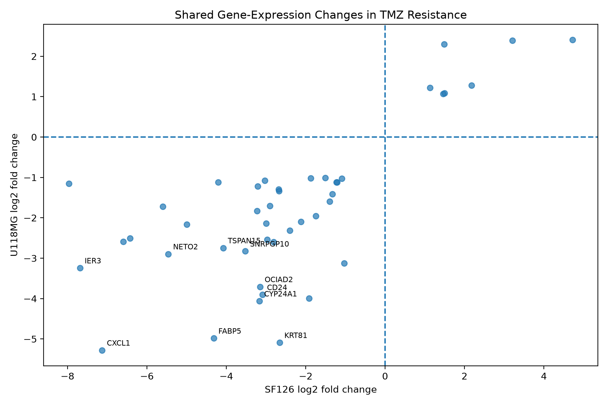

# Exploratory Gene-Expression Patterns in Temozolomide-Resistant Glioblastoma Cell Models

**Salma Mifdal**  
Independent Computational Biology Research Portfolio  
October 2026

*This report is a computational reanalysis of an existing public dataset, not a laboratory experiment or a peer-reviewed publication.*

## Abstract

Temozolomide (TMZ) resistance remains an important challenge in glioblastoma research. I explored gene-expression differences between TMZ-sensitive and TMZ-resistant SF126 and U118MG cell models using the publicly available Gene Expression Omnibus dataset GSE327029 (National Center for Biotechnology Information [NCBI], 2026).

The dataset contained 60,498 gene entries and 12 samples across four experimental groups. Using Python, I calculated average expression for each group and a pseudocount-adjusted log2 fold change for each cell model.

Forty-four gene entries met the exploratory selection criteria: 37 had lower expression and 7 had higher expression in resistant cells in both models. KPNA3 and MGMT showed higher average RNA expression in both resistant models, while STAT3 showed opposite directions between the models.

There were no missing expression measurements or duplicate gene identifiers, and within-group sample correlations ranged from .972 to .997. These findings describe patterns in the dataset; they do not demonstrate statistical significance or establish that any gene causes drug resistance.

**Keywords:** glioblastoma, temozolomide, RNA sequencing, gene expression, bioinformatics

## Introduction

Glioblastoma is an aggressive brain cancer for which temozolomide is an important treatment. However, treatment response varies, and drug resistance remains a challenge (Stupp et al., 2005). The DNA-repair protein MGMT has also been linked to differences in response to temozolomide (Hegi et al., 2005).

RNA-sequencing data allow researchers to compare how much RNA is measured for each gene under different experimental conditions. These comparisons can suggest genes worth studying further, but they cannot establish causation on their own.

In this project, I reanalyzed a publicly available dataset from a study of temozolomide-resistant glioblastoma cell models (NCBI, 2026).

**Research question:** Which gene-expression patterns differ between TMZ-sensitive and TMZ-resistant glioblastoma cell models, and which changes occur in the same direction in both SF126 and U118MG?

My goal was to develop a reproducible Python workflow, summarize the strongest shared descriptive patterns, and explain the limitations of the analysis.

## Method

### Dataset and Sample Groups

I used the public NCBI Gene Expression Omnibus dataset GSE327029, supplied as the decompressed gene-level TPM matrix `GSE327029_mRNA-12.TPM.genes.tsv` (NCBI, 2026).

It contained 60,498 gene entries and 14 columns: gene ID, gene name, and expression measurements for 12 samples.

| Group | Samples |
|---|---|
| SF126 sensitive | SF126-1, SF126-2, SF126-3 |
| SF126 resistant | SF126R-1, SF126R-2, SF126R-3 |
| U118MG sensitive | U118MG-1, U118MG-2, U118MG-3 |
| U118MG resistant | U118MGR-1, U118MGR-2, U118MGR-3 |

The SF126 and U118MG comparisons were performed separately. I did not independently confirm whether the three labeled samples in each group were biologically independent replicates.

### Computational Workflow

I used Python, pandas, NumPy, and Matplotlib.

For each gene entry, I first calculated mean TPM in each of the four sample groups. I then compared the resistant and sensitive means within each cell model using:

**log2FC = log2[(mean resistant TPM + 1) / (mean sensitive TPM + 1)]**

The added value of 1 is a *pseudocount* that prevents division by zero.

Positive values represent higher average RNA expression in resistant cells; negative values represent lower average RNA expression.

The pseudocount can substantially affect results when TPM values are near zero, so this measure was used for descriptive exploration rather than formal differential-expression testing.

### Candidate Selection and Quality Checks

I selected a gene entry if its change had the same nonzero direction in both cell models, its absolute pseudocount-adjusted log2FC was at least 1 in each model, and at least one condition had a mean TPM of 5 or higher within each model.

I ranked the selected entries by the smaller of their two absolute changes. These thresholds were practical screening choices, not statistical significance criteria.

I also checked for missing values and duplicate gene identifiers. To assess sample consistency, I calculated pairwise Pearson correlations within each group using log2(TPM + 1) values.

Finally, I created a scatter plot comparing the two model-specific log2FC values for the selected candidates.

## Results

### Dataset and Sample Consistency

The dataset had **no missing expression measurements** and **no duplicate gene IDs**.

Within-group sample correlations ranged from .972 to .997. Most pairs had correlations of .996 or .997.

Correlations involving U118MG-1 with U118MG-2 and U118MG-3 were both .972, whereas the correlation between U118MG-2 and U118MG-3 was .997.

This difference deserves closer examination, but it does not by itself show that the sample was invalid.

### Shared Candidate Genes

Forty-four of the 60,498 gene entries met the exploratory selection criteria.

Of those, **37 showed lower mean expression** and **7 showed higher mean expression** in resistant cells in both models.

**Table 1**

*Top Ten Exploratory Gene Entries With Shared Directional Changes*

| Gene | SF126 log2FC | U118MG log2FC |
|---|---:|---:|
| CXCL1 | -7.127 | -5.281 |
| FABP5 | -4.318 | -4.984 |
| IER3 | -7.685 | -3.244 |
| CYP24A1 | -3.165 | -4.063 |
| OCIAD2 | -3.152 | -3.709 |
| CD24 | -3.093 | -3.905 |
| NETO2 | -5.459 | -2.897 |
| SNRPGP10 | -3.521 | -2.828 |
| TSPAN15 | -4.079 | -2.747 |
| KRT81 | -2.657 | -5.091 |

*Note.* The values are descriptive, pseudocount-adjusted log2 fold changes. Negative values indicate lower average expression in resistant samples. The 37-to-7 split refers only to genes passing the stated filters, not to all 60,498 entries.

**Figure 1**

*Shared Gene-Expression Changes in Two TMZ-Resistance Cell Models*

*Note.* Each point represents one selected gene entry. The horizontal axis shows SF126 log2FC; the vertical axis shows U118MG log2FC. The lower-left quadrant contains entries with lower expression in both resistant models, and the upper-right contains entries with higher expression in both. The plot does not show statistical significance.

### Genes Discussed in the Source Study

I also examined three genes connected to the original study's research focus (NCBI, 2026).

**Table 2**

*Exploratory Expression Changes for KPNA3, MGMT, and STAT3*

| Gene | SF126 log2FC | U118MG log2FC |
|---|---:|---:|
| KPNA3 | +5.432 | +0.449 |
| MGMT | +4.401 | +0.735 |
| STAT3 | -0.619 | +0.341 |

*Note.* KPNA3 and MGMT had higher mean TPM in both resistant groups. STAT3 changed in opposite directions between models. Values are derived from TPM group means with a pseudocount of 1.

For KPNA3, the SF126 mean increased from 0.00 to 42.18 TPM, while the U118MG mean increased from 36.44 to 50.12 TPM.

For MGMT, the corresponding changes were 0.01 to 20.33 TPM and 4.72 to 8.52 TPM. Because the sensitive SF126 means were at or near zero, the large calculated log2FC values for these genes depend strongly on the pseudocount.

STAT3 expression was lower in resistant SF126 cells but higher in resistant U118MG cells. RNA abundance alone cannot establish whether STAT3 protein signaling was activated.

## Discussion

The clearest result was a group of 44 gene entries with expression changes in the same direction across the two models.

CXCL1, FABP5, IER3, CYP24A1, and OCIAD2 showed especially large descriptive decreases under the selected calculation. These are possible starting points for further research, not confirmed resistance biomarkers.

KPNA3 and MGMT had higher mean RNA expression in the resistant conditions of both cell models.

The MGMT finding is biologically relevant because MGMT is involved in repairing DNA damage associated with the action of temozolomide (Hegi et al., 2005).

Still, a higher RNA measurement does not prove that MGMT or KPNA3 caused resistance in these samples.

STAT3 changed in different directions between the models, showing why it is important not to assume that two cell models behave identically. In particular, RNA expression is not a direct measurement of STAT3 activation.

I also learned an important research lesson from the quality checks. Even when correlations are high, they do not establish that replicates were independent, eliminate possible batch effects, or replace a complete RNA-sequencing quality-control assessment.

### Limitations

This project used TPM-normalized values, not raw RNA-sequencing counts, and did not perform statistical differential-expression testing or calculate p-values or false-discovery rates.

Adding 1 to mean TPM values especially affects low-expression genes, and different candidate-selection thresholds could produce different gene lists.

Both comparisons came from one GEO study, not from independently collected datasets. I did not fully audit sample metadata, batch effects, or biological replicate independence.

Finally, the findings were not tested in a laboratory or validated in patient samples.

For these reasons, the results cannot establish causation, clinical relevance, or a new treatment target.

### Future Research

A stronger follow-up would begin with raw sequencing counts and verified sample metadata.

It could then apply appropriate statistical differential-expression methods within each cell model, evaluate potential batch effects, and perform pathway analysis.

Comparing the findings with independent datasets would help determine whether the observed patterns are reproducible.

Experimental work would be necessary to investigate any causal role in resistance.

## Conclusion

Using a public glioblastoma RNA-sequencing dataset, I developed a Python workflow to compare sensitive and resistant cell models.

The exploratory analysis identified **44 candidate gene entries**, including **37 with lower** and **7 with higher** expression in resistant cells across both models.

It also described KPNA3, MGMT, and STAT3 expression patterns and assessed basic sample consistency.

These results do not confirm statistically significant differential expression or a biological mechanism, but the project demonstrates practical skills in data processing, visualization, quality checks, reproducibility, and scientific communication.

## Data and Code Availability

The analysis code, results tables, and figure are available at:

https://github.com/salmamifdal/GBM-TMZ-Resistance-Analysis

The original dataset can be accessed through GEO accession GSE327029 (NCBI, 2026). The repository's `README.md` contains instructions for reproducing the analysis.

## References

Hegi, M. E., Diserens, A. C., Gorlia, T., Hamou, M. F., de Tribolet, N., Weller, M., Kros, J. M., Hainfellner, J. A., Mason, W., Mariani, L., Bromberg, J. E. C., Hau, P., Mirimanoff, R. O., Cairncross, J. G., Janzer, R. C., & Stupp, R. (2005). MGMT gene silencing and benefit from temozolomide in glioblastoma. *The New England Journal of Medicine, 352*(10), 997–1003. https://doi.org/10.1056/NEJMoa043331

National Center for Biotechnology Information. (2026). *GSE327029: KPNA3 drives temozolomide resistance in glioblastoma by upregulating MGMT and activating STAT3 to sustain glioma stem cells* [Data set]. Gene Expression Omnibus. https://www.ncbi.nlm.nih.gov/geo/query/acc.cgi?acc=GSE327029

Stupp, R., Mason, W. P., van den Bent, M. J., Weller, M., Fisher, B., Taphoorn, M. J., Belanger, K., Brandes, A. A., Marosi, C., Bogdahn, U., Curschmann, J., Janzer, R. C., Ludwin, S. K., Gorlia, T., Allgeier, A., Lacombe, D., Cairncross, J. G., Eisenhauer, E., & Mirimanoff, R. O. (2005). Radiotherapy plus concomitant and adjuvant temozolomide for glioblastoma. *The New England Journal of Medicine, 352*(10), 987–996. https://doi.org/10.1056/NEJMoa043330
